# Combat

The 'Combat' tab gives you all the tools you need to build and run combat encounters in your games. Here you can spawn mobs, create spell effects, toggle map effects, link maps to the encounter, and interact with the combat initiative.

|                                                                                      Button                                                                                      | Action                                                                                                                                                                                                                                                                                                                                                                 |
| :------------------------------------------------------------------------------------------------------------------------------------------------------------------------------: |------------------------------------------------------------------------------------------------------------------------------------------------------------------------------------------------------------------------------------------------------------------------------------------------------------------------------------------------------------------------|
|            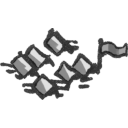 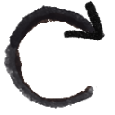             | The **New Map** button allows you to select a new map for the combat encounter. All maps listed in the campaign tree are listed as available map selections; in order to display the map you must press the **Refresh** button. I like to nest my encounters under the map they are related to, under the adventure they fall into.                                    |
|  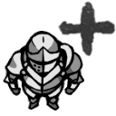 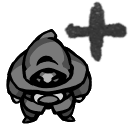  | The **Add PC** and **Add NPC** buttons add a PC or an NPC from the campaign to the combat.                                                                                                                                                                                                                                                                             |
| 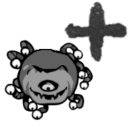 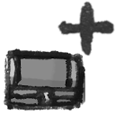 | The **Add Mob/Object** buttons are all used to add their respective mob, the object for special objects on the map *(get creative, you can add any image and scale it appropriately)*, on the fly. These functions are great for moments where you need to scale up your encounter because your party destroys all your plans. *Remember the Tarrasques… Just saying.* |

## Spell Effects

|                                                                                                                                                                                           Button                                                                                                                                                                                           | Action                                                                                                                                                                                                                                                                                                                                                                                                                                        |
| :----------------------------------------------------------------------------------------------------------------------------------------------------------------------------------------------------------------------------------------------------------------------------------------------------------------------------------------------------------------------------------------: | --------------------------------------------------------------------------------------------------------------------------------------------------------------------------------------------------------------------------------------------------------------------------------------------------------------------------------------------------------------------------------------------------------------------------------------------- |
| 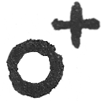 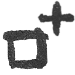 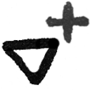 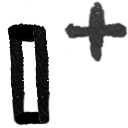 | The map effect functions let you add new shapes that represent spell affects to the map where they can be individually sized, and named. You can create a **Radius**, **Cube**, **Cone**, or **Line** effect, and any affected targets will highlight in a burgundy color. Once the spell effect is created you can right click on the effect to edit the effect, delete the effect, or roll a save for every target affected(See more pg x). |

## Map Effects

The map effect functions are five toggleable buttons that toggle different map effect on or off on both the 'DM View' and the 'Player Window'. These range from showing dead mobs to enabling token movement areas.

|                                        Button                                         | Action                                                                                                                                                                         |
| :-----------------------------------------------------------------------------------: | ------------------------------------------------------------------------------------------------------------------------------------------------------------------------------ |
|  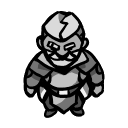   | The **Show Living** button toggles whether to show or hide all living combatants                                                                                               |
|    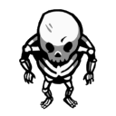     | The **Show Dead** button toggles whether to show or hide all combatants whose HP is 0, which may be important if certain mobs have certain special loot on them.               |
| 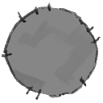  | The **Show Effects** button toggles whether to show or hide all spell effects that are active, this is especially helpful if the map begins to get cluttered by spell effects. |
|   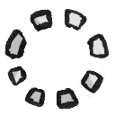   | The **Movement** button toggles whether the movement radius for mobs and PCs should be shown when moving them on the map.                                                      |
|   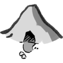   | The **Lair Actions** if selected, DMH will remind you to run lair actions when the initiative order passes 20                                                                  |
|       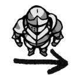       | The **Next** button activates the next combatant in the initiative order.                                                                                                      |
|       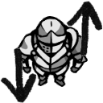       | The **Sort** button resorts the widgets by their initiative values (highest to lowest).                                                                                        |
| 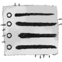 | If you click the **Statistics** button, you can see the overall statistics of the combat, including who has dealt and taken damage so far.                                     |
